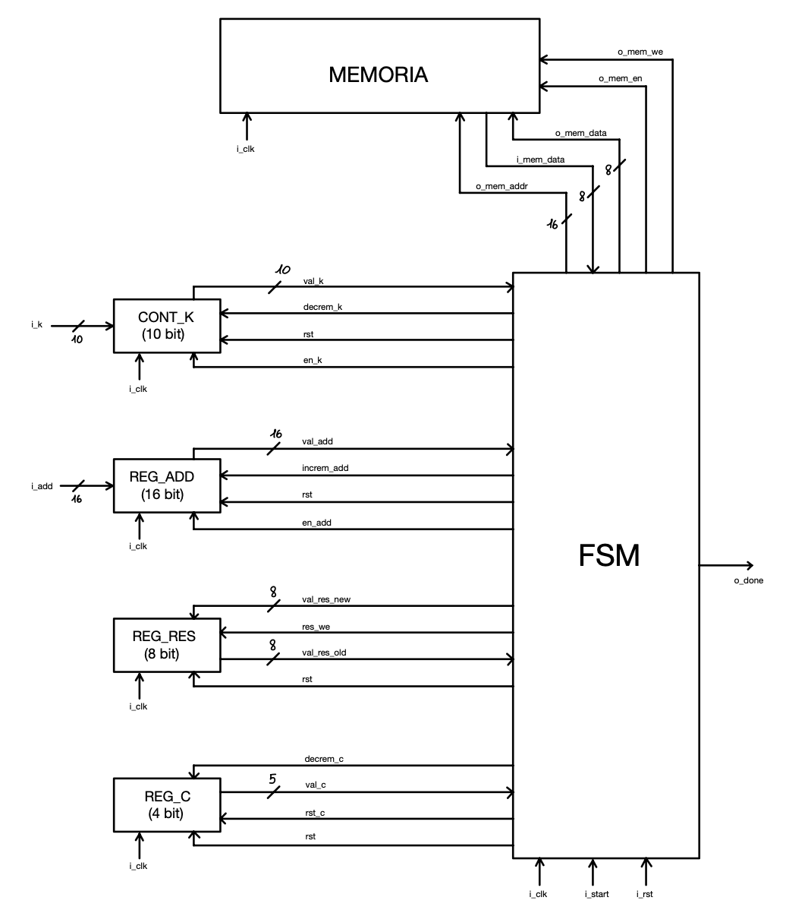
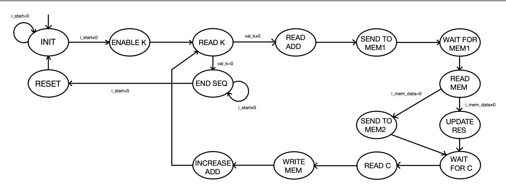

# ⚡ Digital Logic Design Project – Prova finale di Reti Logiche

Progetto di coppia per la **Prova finale (Progetto di Reti Logiche)**, **Politecnico di Milano**, A.A. 2023/24.

Un modulo hardware descritto in **VHDL** che legge da una memoria esterna una sequenza di dati incompleta, la **completa** sostituendo i valori mancanti e assegna a ogni parola un **valore di credibilità**. Il componente è stato sintetizzato e verificato in simulazione sia prima sia dopo la sintesi.

📄 **[Relazione del progetto (PDF)](./Relazione.pdf)** · 💾 **[Codice VHDL](./project_reti_logiche.vhd)**

## Il problema

In memoria, a partire da un indirizzo `ADD`, si trova una sequenza di **K parole** da un byte (valori da 0 a 255), una ogni due indirizzi. Lo zero non è un dato valido ma indica un valore mancante. Il modulo deve:

- sostituire ogni zero con l'**ultimo valore valido** letto in precedenza;
- scrivere nell'indirizzo successivo a ogni parola un **valore di credibilità C**: torna a **31** quando la parola è valida e cala di 1 a ogni zero consecutivo, fino a un minimo di 0;
- lasciare a zero le parole nulle all'inizio della sequenza, quando non esiste ancora un valore valido da cui copiare.

Per esempio la sequenza `64 0 19 0 23 0 4 0 0 0 0 0 13 0 128 0 0 0` diventa `64 31 19 31 23 31 4 31 4 30 4 29 13 31 128 31 128 30`.

## Architettura

Il componente è formato da una **macchina a stati finiti** che controlla quattro registri/contatori e la comunicazione con la memoria. I registri non comunicano tra loro ma solo con la FSM: tutto il controllo è centralizzato, il che rende il progetto più semplice da verificare e da estendere.

| Componente | Bit | Ruolo |
|---|---|---|
| `COUNT_K` | 10 | Parole ancora da elaborare: si carica con K e si decrementa a ogni parola |
| `REG_ADD` | 16 | Indirizzo di lettura/scrittura: si carica con ADD e si incrementa |
| `REG_RES` | 8 | Ultimo valore valido letto, usato per sostituire gli zeri |
| `REG_C` | 5 | Valore di credibilità: torna a 31 o si decrementa, senza scendere sotto lo 0 |

## Macchina a stati

La FSM ha **15 stati** e due processi: uno gestisce il reset asincrono e il passaggio di stato sul fronte di salita del clock, l'altro assegna le uscite in base allo stato corrente. Per ogni parola il ciclo è: lettura dalla memoria, scelta tra aggiornamento del valore valido (parola diversa da zero) o scrittura dell'ultimo valore valido (parola nulla), aggiornamento della credibilità, scrittura di C e avanzamento all'indirizzo successivo.

Alcune scelte progettuali:

- **Reset unificato**: la FSM inoltra a tutti i registri un unico segnale di reset, attivato sia dal reset esterno sia alla fine di ogni sequenza. Così il componente può elaborare **più sequenze consecutive** anche senza un reset dall'esterno.
- **Stati di attesa sfruttati**: i cicli necessari per aspettare la memoria e l'aggiornamento dei registri sono usati per svolgere altre operazioni in parallelo, riducendo il numero di stati.
- **Nessun latch**: in ogni stato tutte le uscite vengono assegnate esplicitamente, quindi la sintesi non genera elementi di memoria indesiderati.

## Test e risultati

Il componente supera tutti i test sia in simulazione **Behavioral** sia in **Post-Synthesis Functional**:

| Test | Pre-sintesi | Post-sintesi |
|---|---|---|
| Sequenza generica | 3570000 ps | 3570100 ps |
| Sequenza con zeri iniziali | 930000 ps | 930100 ps |
| Credibilità che arriva a zero | 8370000 ps | 8370100 ps |
| Sequenze multiple consecutive | 9090000 ps | 9090100 ps |
| Reset durante l'esecuzione | 7290000 ps | 7290100 ps |

Con un clock di 20 ns, la sintesi riporta uno **slack positivo di 16,713 ns** (timing rispettato), e nessun latch viene inferito.

## Il team

**Ilaria Brunelli** ed Elena Brugnolo.
